# Isaac Lab 部署与 Go2 项目流程

> [!summary] 本页目标
> 把原始 ODT 中的安装和训练记录整理成一条可复习的主线：安装 Isaac Lab → 生成外部项目 → 定义 Go2 的 ManagerBased 环境 → 注册 Gym 任务 → 验证 → 训练 → 回放与导出。

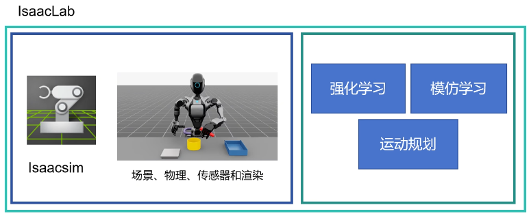

## 1. 先分清 Isaac Sim 与 Isaac Lab

- **Isaac Sim**：机器人仿真平台，负责 USD 场景、物理、传感器和渲染。
- **Isaac Lab**：建立在 Isaac Sim 之上的机器人学习框架，提供环境、任务、强化学习接口和训练工作流。
- **Go2 项目**：在 Isaac Lab 之上定义机器人资产、观测、动作、奖励、终止条件和训练配置。

## 2. 安装记录

原始笔记对应 Isaac Sim 5.1.0 / Isaac Lab 2.3.2 左右的工作流。它是一次实践记录，不应当当作永远有效的最新安装命令。

### 2.1 一键安装入口

```bash
wget -O install_isaaclab.sh https://docs.robotsfan.com/install_isaaclab.sh
bash install_isaaclab.sh
```

参考：[Isaac Lab 一键安装说明](https://docs.robotsfan.com/isaaclab/source/setup/oneclick_installation.html)

### 2.2 手动安装步骤（原始环境记录）

```bash
# 1. 创建并进入 Python 3.11 环境
conda create -n env_isaaclab python=3.11
conda activate env_isaaclab

# 2. 安装与 CUDA 版本匹配的 PyTorch
pip install -U torch==2.7.0 torchvision==0.22.0 \
  --index-url https://download.pytorch.org/whl/cu128

# 3. 安装 Isaac Sim
python -m pip install --upgrade pip
python -m pip install "isaacsim[all,extscache]==5.1.0" \
  --extra-index-url https://pypi.nvidia.com

# 4. 获取 Isaac Lab（SSH 方式需要提前配置 GitHub SSH Key）
git clone git@github.com:isaac-sim/IsaacLab.git
cd IsaacLab

# 5. 安装 Isaac Lab 扩展
./isaaclab.sh --install
```

> [!warning] 不要盲目复制版本号
> PyTorch、CUDA、Isaac Sim 和 Isaac Lab 必须互相兼容。准备重装时，应先查目标 Isaac Lab 版本的官方安装矩阵，再决定 Python、CUDA 和 PyTorch 版本。

## 3. 训练入口的基本概念

Isaac Lab 的强化学习脚本通常位于 `scripts/reinforcement_learning/`。训练和回放需要：

- 一个 Gymnasium **任务 ID**，例如 `Go2-Velocity-v0`；
- 对应的环境配置入口；
- 对应强化学习库的 Agent / PPO 配置入口。

## 4. 生成自己的项目

在旧版工作流中，可从 Isaac Lab 根目录启动模板生成器：

```bash
./isaaclab.sh --new
```

生成器中的关键选择：

| 选择 | 含义 | Go2 学习项目建议 |
|---|---|---|
| External / Internal | 项目在 Isaac Lab 仓库外还是仓库内 | 优先 External，便于独立维护和版本控制 |
| Direct / ManagerBased | 环境逻辑集中编写，还是按配置组件拆分 | 想快速原型可用 Direct；长期维护优先 ManagerBased |
| RL framework | 选择 RSL-RL、RL-Games、SB3 等训练后端 | 四足运动常从 RSL-RL 开始 |

生成外部项目后，在它自己的根目录安装为可编辑包：

```bash
cd ~/go2_robot/go2
python -m pip install -e source/go2
```

## 5. 认识项目结构

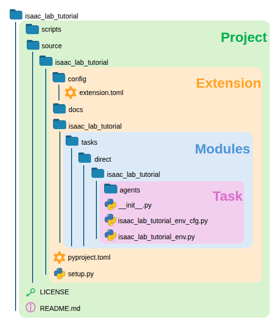

- `scripts/`：训练、回放、零动作、随机动作和调试脚本。
- `source/`：Python 包、任务定义、资产配置和 Agent 配置的核心位置。
- `source/<package>/<package>/tasks/`：任务与环境配置。
- `source/<package>/<package>/assets/`：机器人资产与 `ArticulationCfg`。

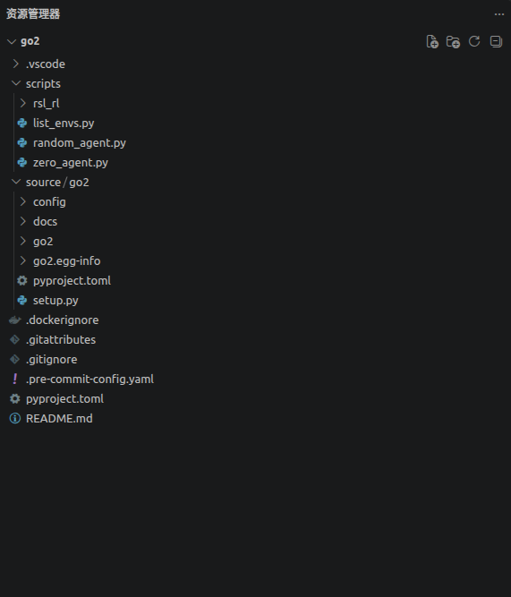

## 6. 创建 ManagerBased Go2 环境

原始项目中的环境配置位置示例：

```text
source/go2/manager_based/go2/go2_velocity.py
```

实际目录会随模板的包名和任务名变化，应以当前项目为准。

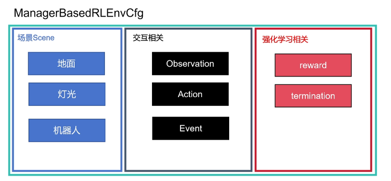

### 6.1 从官方模板开始

先找一个结构相近的官方 ManagerBased locomotion 任务作为参照，再逐步替换：

1. 第三方库与 Isaac Lab 组件导入；
2. 场景配置类；
3. Go2 的 USD / `ArticulationCfg`；
4. 传感器、观测、动作、命令、奖励、终止和事件；
5. 环境总配置与训练配置。

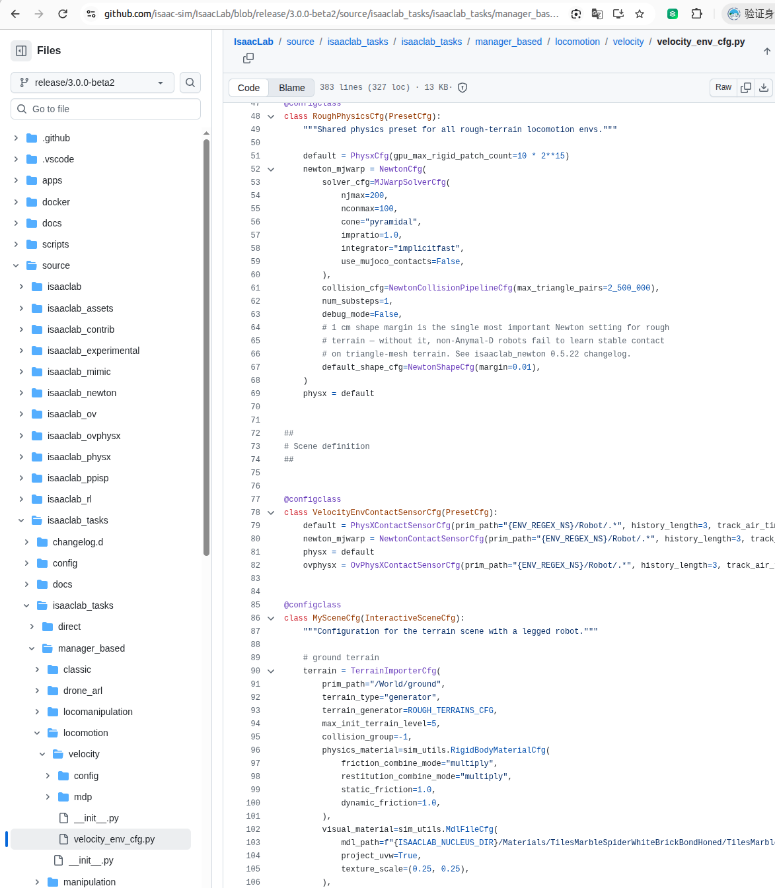

### 6.2 配置 Go2 机器人资产

资产目录示例：

```text
source/go2_demo/go2_demo/assets/
```

> 原 ODT 中写成了 `asstes`，这里已纠正为 `assets`。

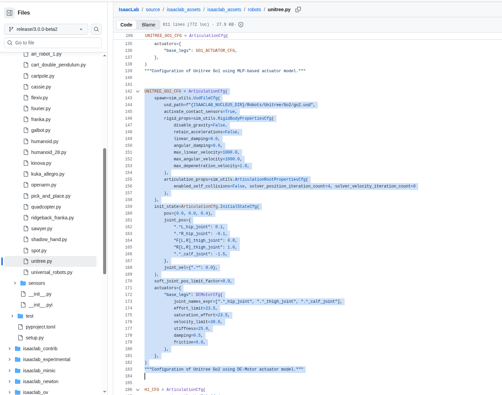

执行器决定关节如何把策略输出转成力矩或目标。显式执行器便于表达电机与控制器特性，是 Sim-to-Real 时需要重点校准的部分。

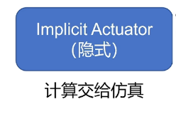

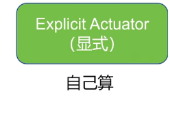

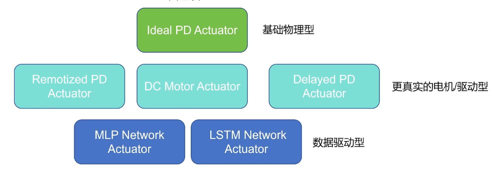

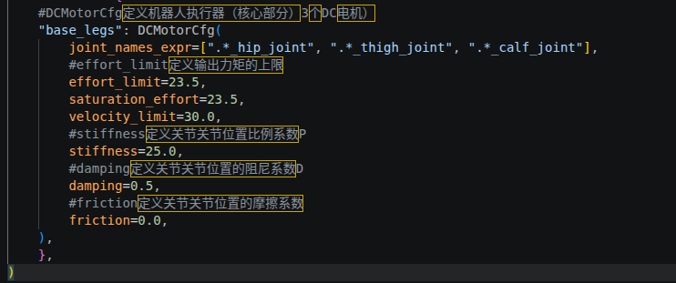

### 6.3 把机器人放入环境

```python
from go2_demo.assets.unitree import UNITREE_GO2_CFG as RobotCFG

robot: ArticulationCfg = RobotCFG.replace(
    prim_path="{ENV_REGEX_NS}/Robot"
)
```

### 6.4 添加传感器和灯光

```python
height_scanner = RayCasterCfg(
    prim_path="{ENV_REGEX_NS}/Robot/base",
    offset=RayCasterCfg.OffsetCfg(pos=(0.0, 0.0, 20.0)),
    ray_alignment="yaw",
    pattern_cfg=patterns.GridPatternCfg(resolution=0.1, size=[1.6, 1.0]),
    debug_vis=False,
    mesh_prim_paths=["/World/ground"],
)

contact_forces = ContactSensorCfg(
    prim_path="{ENV_REGEX_NS}/Robot/.*",
    history_length=3,
    track_air_time=True,
)

sky_light = AssetBaseCfg(
    prim_path="/World/skyLight",
    spawn=sim_utils.DomeLightCfg(
        intensity=750.0,
        texture_file=(
            f"{ISAAC_NUCLEUS_DIR}/Materials/Textures/Skies/"
            "PolyHaven/kloofendal_43d_clear_puresky_4k.hdr"
        ),
    ),
)
```

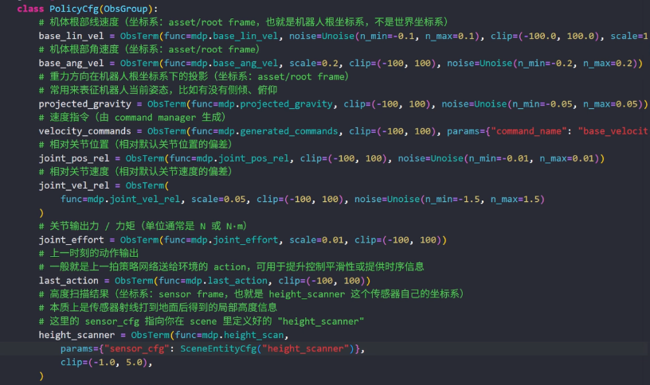

> [!note] 需要复核的参数
> 高度扫描器偏移 `z=20.0` 很可能只是当时的调试值。用于 Go2 时应根据机器人尺度、射线方向和地形范围重新确认。

## 7. 强化学习环境的七类配置

### 7.1 观测（Observations）

策略能看到的信息，例如机身角速度、投影重力、速度命令、关节位置/速度、上一时刻动作和高度扫描结果。

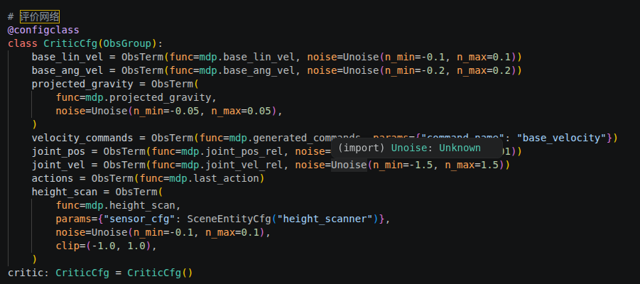

### 7.2 动作（Actions）

策略输出如何映射到关节目标。要记录动作缩放、关节顺序、是否使用默认关节位置偏置等。

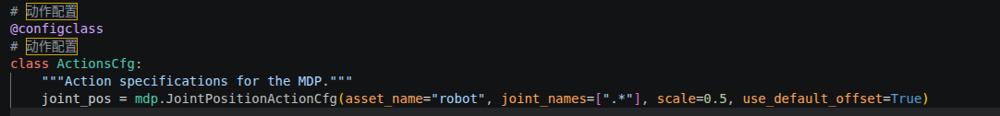

### 7.3 命令（Commands）

定义期望线速度、角速度、朝向和采样范围，它决定“机器人被要求完成什么”。

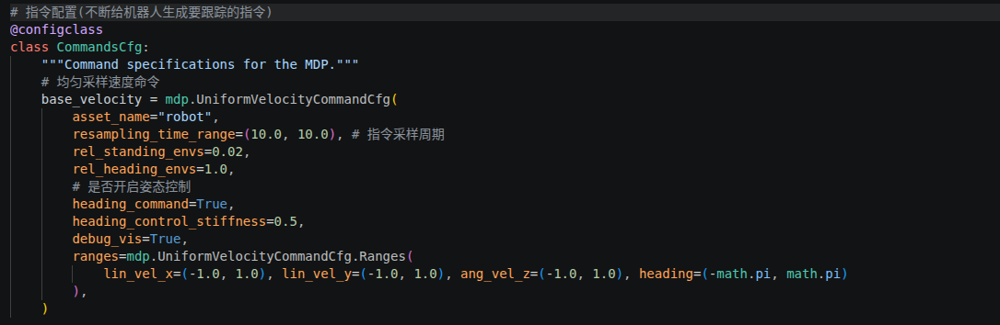

### 7.4 奖励（Rewards）

奖励决定策略优化方向。常见项包括速度跟踪、角速度跟踪、足端离地时间、能耗、动作变化、姿态和碰撞惩罚。

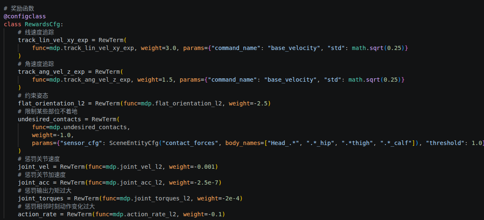

### 7.5 终止条件（Terminations）

定义回合何时结束，例如超时、机身触地、姿态异常或越界。

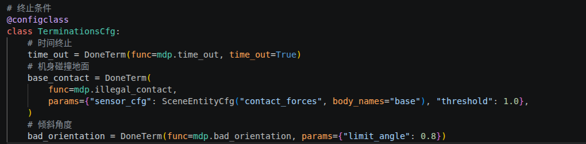

### 7.6 事件（Events）

用于重置、随机化质量/摩擦、施加扰动、初始化关节状态等，是域随机化和 Sim-to-Real 的重要入口。

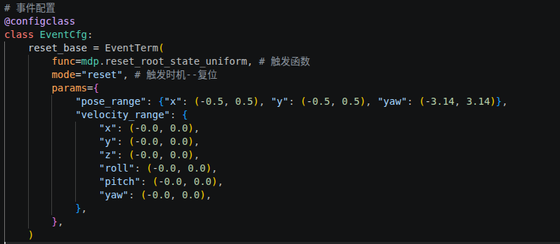

### 7.7 环境总配置

把场景、观测、动作、命令、奖励、终止、事件和课程学习组合起来，并设置 `decimation`、episode 时长、仿真步长等全局参数。

## 8. 注册 Gymnasium 任务

注册文件示例：

```text
source/go2_demo/go2_demo/tasks/manager_based/go2_demo/__init__.py
```

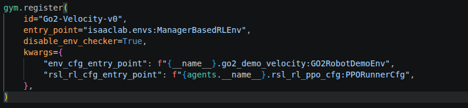

注册时最重要的是任务 `id`、环境配置入口 `env_cfg_entry_point`，以及训练库对应的 Agent 配置入口。

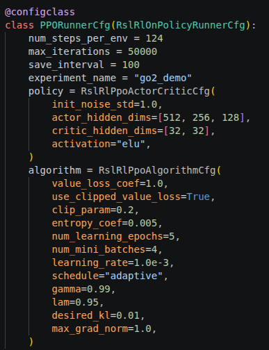

## 9. 配置 PPO

RSL-RL PPO 配置文件示例：

```text
source/go2_demo/go2_demo/tasks/manager_based/go2_demo/agents/rsl_rl_ppo_cfg.py
```

重点记录：网络结构、激活函数、学习率、每次 rollout 步数、训练轮数、熵系数、折扣因子和保存间隔。

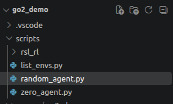

## 10. 训练前验证

在真正训练前，先运行零动作和随机动作脚本，确认：

- 任务能够被 Gymnasium 找到；
- 环境可以创建和重置；
- 观测维度、动作维度与关节数量一致；
- 机器人不会因为 USD、碰撞、初始姿态或执行器错误立刻爆炸；
- Headless 和带界面模式都能正常退出。

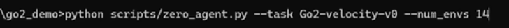

### 10.1 零动作测试

原始记录中的 `zero_angent.py` 是拼写错误，通常应为 `zero_agent.py`。

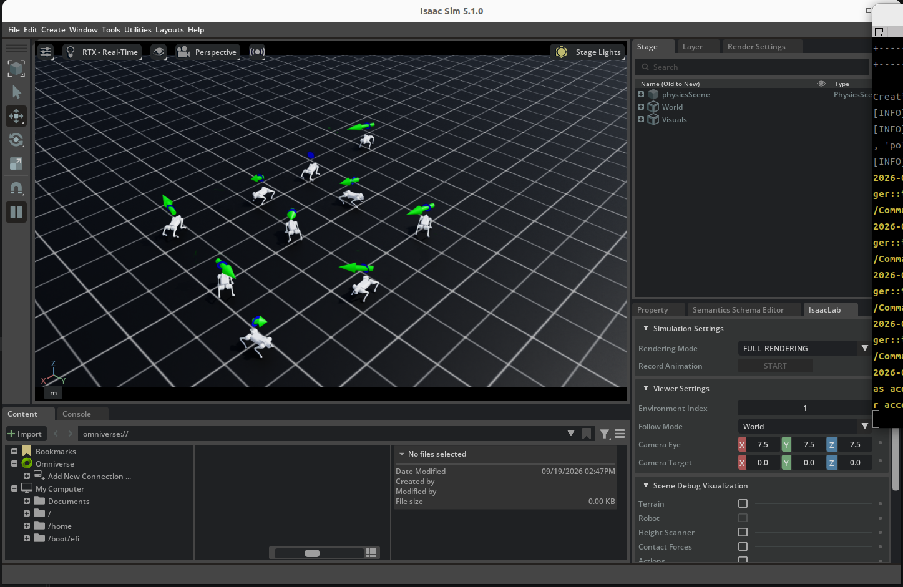

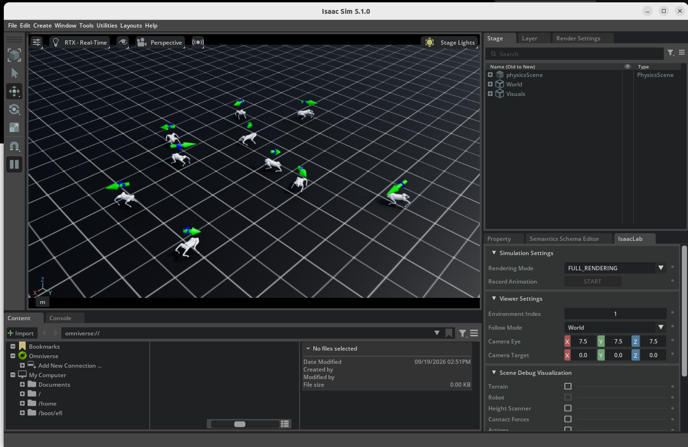

### 10.2 随机动作测试

随机动作测试用于暴露动作维度、关节映射、数值范围和碰撞稳定性问题。它不代表策略已经学会运动。

## 11. 训练、日志与回放

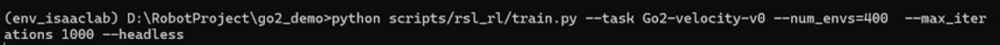

训练时至少记录：Git commit、Isaac Lab 版本、任务 ID、随机种子、环境数量、奖励修改、开始时间和输出目录。

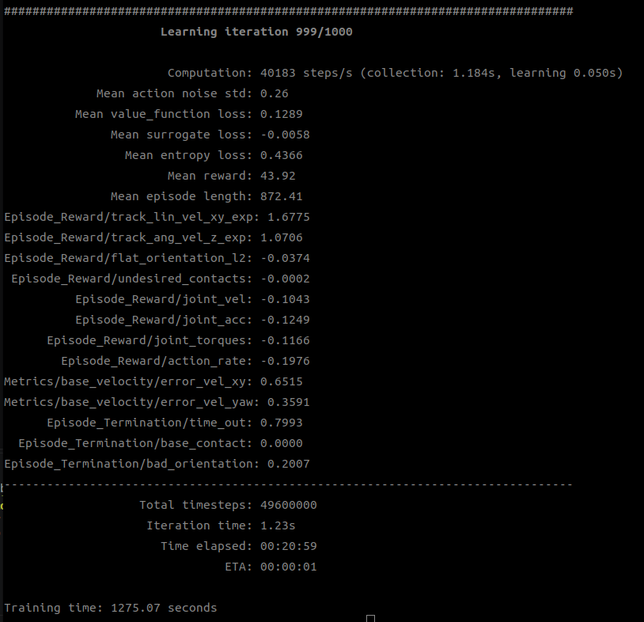

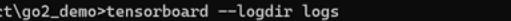

回放示例：

```bash
python scripts/rsl_rl/play.py \
  --task Go2-Velocity-v0 \
  --num_envs 16
```

> [!note] 参数名以脚本帮助为准
> 原笔记写的是 `--num_env 16`。不同版本可能使用 `--num_envs`，运行前请执行 `python scripts/rsl_rl/play.py --help` 核对。

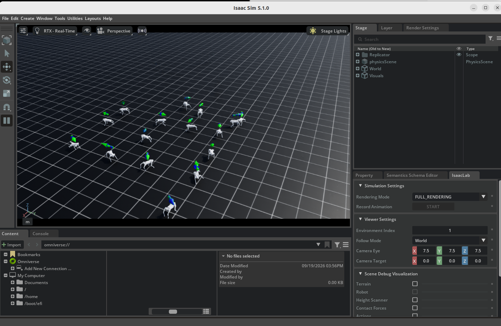

训练完成后，导出文件可能位于类似目录：

```text
logs/rsl_rl/go2_demo/2026-09-19_15-01-41/exported/
├── policy.pt
└── policy.onnx
```

实际文件名和目录取决于版本与导出脚本。

## 12. 下一步检查清单

- [ ] 记录本机 GPU、驱动、CUDA、Python、Isaac Sim 和 Isaac Lab 版本。
- [ ] 用 `--help` 核对训练、回放、零动作和随机动作脚本参数。
- [ ] 检查 Go2 的质量、惯量、碰撞体、关节限制和执行器参数。
- [ ] 为观测、动作、奖励、终止条件分别写最小验证。
- [ ] 固定一份能复现的基线配置，再一次只修改一类参数。
- [ ] 把每次实验结论写入[学习日志](../学习日志/)，不要只保留终端截图。

## 13. 原始资料

原始 ODT 已保存在 `原始资料/Isaaclab基础教学_原始记录.odt`。本页对内容做了分段、纠错和版本风险标注，但截图仍按原文顺序保留。
